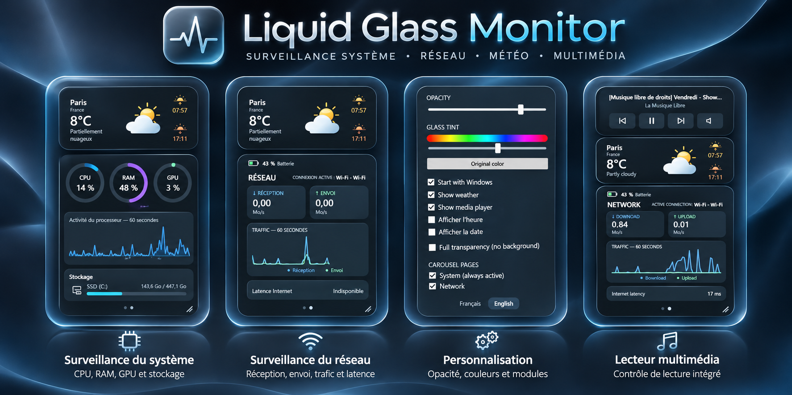
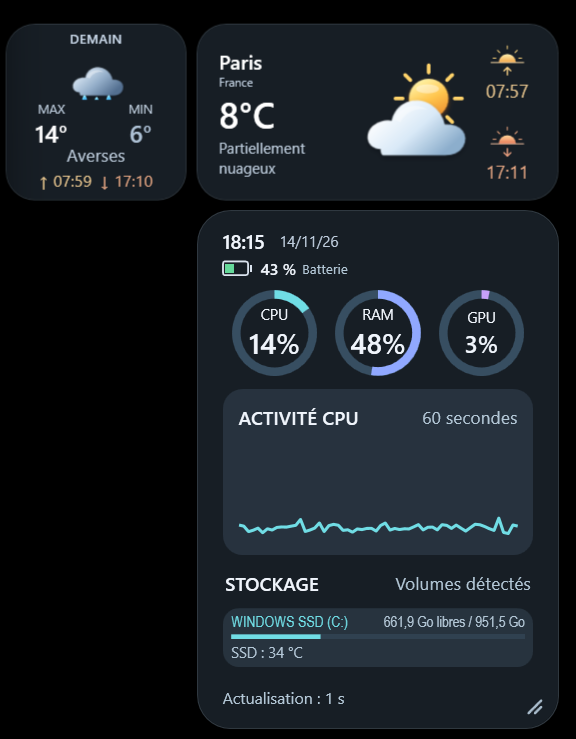
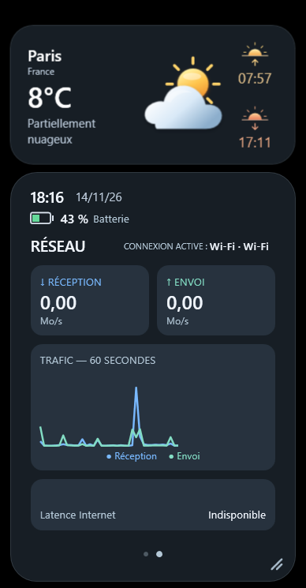
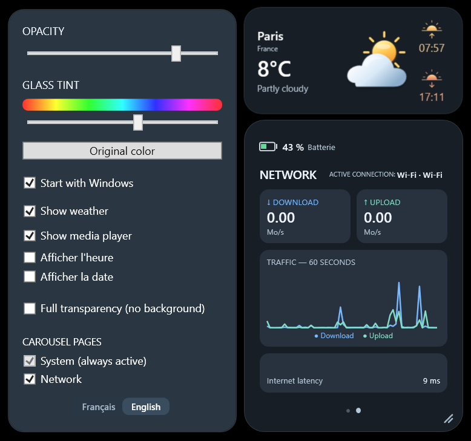
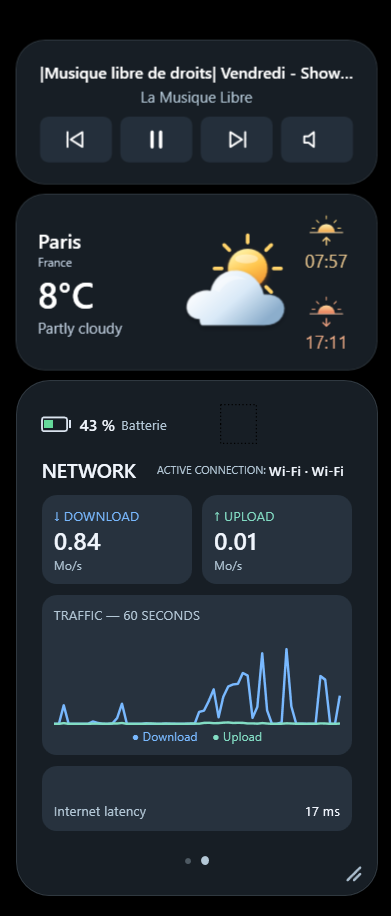

<!-- DEBUT BANNIERE LIQUID GLASS MONITOR -->
<p align="center">
  
</p>
<!-- FIN BANNIERE LIQUID GLASS MONITOR -->

# Liquid Glass Monitor

Application de surveillance materielle pour Windows.

**Auteur :** chosebleu

## Presentation

Liquid Glass Monitor est une application Windows developpee en C# avec WPF et .NET 10.
Elle propose une interface inspiree du verre translucide et plusieurs modules de surveillance du systeme.

## Technologies

- C#
- WPF
- .NET 10
- LibreHardwareMonitorLib

## Compilation

Installer le SDK .NET 10, puis executer depuis le dossier du projet :

```powershell
dotnet restore LiquidGlassMonitor.csproj
dotnet build LiquidGlassMonitor.csproj -c Release
```

## Compatibilite

Application destinee a Windows. La disponibilite des mesures depend du materiel et des pilotes.

## Distribution et licence

Liquid Glass Monitor est un logiciel libre et open source, distribue
sous licence Mozilla Public License 2.0 (MPL-2.0).

Son code source peut etre consulte, utilise, modifie et redistribue,
y compris dans un cadre commercial, conformement aux conditions
de la licence MPL-2.0.

Les bibliotheques et composants tiers conservent leurs propres licences.
Leur inventaire et les informations de conformite figurent dans
[THIRD-PARTY-NOTICES.md](THIRD-PARTY-NOTICES.md).

Le fichier [LICENSE](LICENSE) contient le texte de la MPL-2.0.

Le code source est disponible dans ce depot.

Aucun executable Windows precompile n'est distribue officiellement
pour le moment. Les licences des composants tiers doivent etre respectees.

## Captures d'écran

Découvrez les principales fonctions de Liquid Glass Monitor.

### Surveillance du système



### Surveillance du réseau



### Personnalisation



### Lecteur multimédia



<!-- FIN GALERIE LIQUID GLASS MONITOR -->
