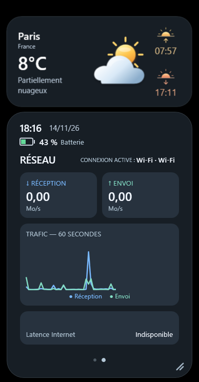
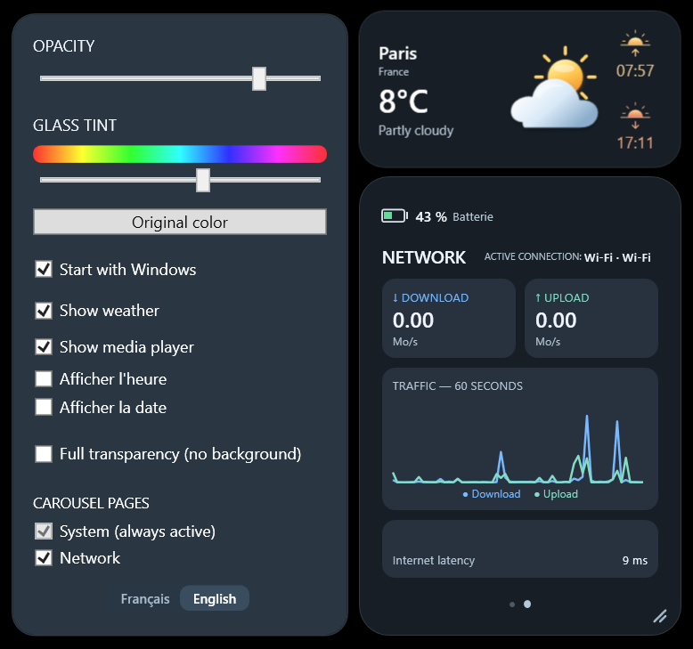

<!-- DEBUT BANNIERE LIQUID GLASS MONITOR -->
<p align="center">
  
</p>
<!-- FIN BANNIERE LIQUID GLASS MONITOR -->

# Liquid Glass Monitor

Hardware monitoring application for Windows.

**Author:** chosebleu

[Version francaise](README.md)

## Overview

Liquid Glass Monitor is a Windows application developed in C# using WPF and .NET 10.
It features a translucent glass-inspired interface and several system monitoring modules.

## Technologies

- C#
- WPF
- .NET 10
- LibreHardwareMonitorLib

## Building

Install the .NET 10 SDK, then run these commands from the project directory:

```powershell
dotnet restore LiquidGlassMonitor.csproj -r win-x64 -p:Platform=x64
dotnet build LiquidGlassMonitor.csproj -c Release -r win-x64 -p:Platform=x64
```

## Windows distributions

Two Windows x64 distributions have been prepared:

- **Lightweight version (8.11 MB)**: requires the .NET 10 Desktop Runtime x64.
- **Self-contained version (68.23 MB)**: includes the required .NET runtime.

Both versions can be used without a traditional installer:
extract the ZIP archive into a folder and launch `LiquidGlassMonitor.exe`.

The files will be made available in the repository's Releases section
when the official release is published.

Some hardware measurements may require administrator privileges
or specific drivers.
## Compatibility

Designed for Windows. Sensor availability depends on hardware and drivers.

## Distribution and license

Liquid Glass Monitor is free and open-source software distributed
under the Mozilla Public License 2.0 (MPL-2.0).

Its source code may be used, modified, and redistributed, including
for commercial purposes, subject to the MPL-2.0 license terms.

Third-party libraries and components retain their respective licenses.
See [THIRD-PARTY-NOTICES.md](THIRD-PARTY-NOTICES.md)
for the dependency inventory and compliance information.

The [LICENSE](LICENSE) file contains the MPL-2.0 license text.

The source code is available in this repository.

No precompiled Windows executable is officially distributed at this time.
Third-party component licenses must be respected.

## Screenshots

Explore the main features of Liquid Glass Monitor.

### System monitoring


### Network monitoring



### Customization



### Media player


<!-- FIN GALERIE LIQUID GLASS MONITOR -->
