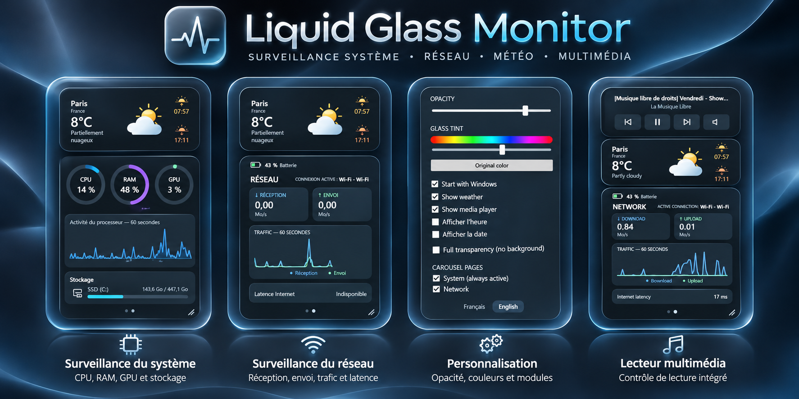
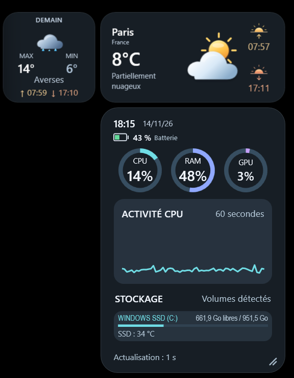
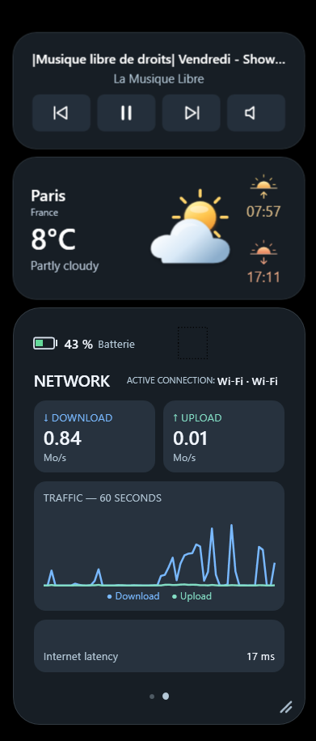

<!-- DEBUT BANNIERE LIQUID GLASS MONITOR -->

  

<!-- FIN BANNIERE LIQUID GLASS MONITOR -->

# Liquid Glass Monitor

Hardware monitoring application for Windows.

**Author:** chosebleu

[Version francaise](README.md)

## Overview

Liquid Glass Monitor is a Windows application developed in C# using WPF and .NET 10.
It features a translucent glass-inspired interface and several system monitoring modules.

## Technologies

- C#
- WPF
- .NET 10
- LibreHardwareMonitorLib

## Building

Install the .NET 10 SDK, then run these commands from the project directory:

    dotnet restore LiquidGlassMonitor.csproj
    dotnet build LiquidGlassMonitor.csproj -c Release

## Compatibility

Designed for Windows. Sensor availability depends on hardware and drivers.

## License

License information and third-party notices will be added before public release.

<!-- DEBUT GALERIE LIQUID GLASS MONITOR -->

## Screenshots

Explore the main features of Liquid Glass Monitor.

### System monitoring

### Network monitoring

### Customization

### Media player

<!-- FIN GALERIE LIQUID GLASS MONITOR -->
